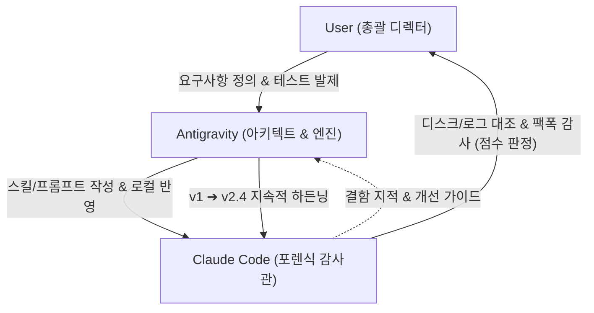

# Universal Critique Architect (범용 팩폭 비평 전략가)

> **환각 없는 근거 기반 팩트 폭격을 가하도록 다중 AI 도구별 맞춤형 모델·설정·프롬프트를 설계하는 범용 비평 스킬 및 오케스트레이션 프레임워크**

---

## 1. 프로젝트 탄생 배경 (Why This Project Exists)

개발자나 기획자, 연구자가 작업한 창작물(코드, 아키텍처, 사업 기획서, 학술 논문, 시나리오 등)을 외부에 당당히 공개하기 전에는 언제나 다음과 같은 딜레마에 부딪힙니다:

- **완성도에 대한 불안과 객관적 검증의 부재:** 내가 만든 작업물의 빈틈과 결함이 무엇인지 알고 싶지만, 지인이나 동료의 피드백은 대개 칭찬 위주이거나 피상적입니다.
- **인간 전문가 섭외의 현실적 장벽:** 분야별 최정상급 전문가에게 철저한 리뷰를 요청하려면 막대한 자문 비용이 들고, 바쁜 일정 속에서 시간을 내어달라 부탁하기도 어렵습니다.
- **AI 기반 자비 없는 '매타작'의 필요성:** 친절한 위로나 애매한 칭찬 대신, 내 작업물이 어디서 왜 깨지는지 **실제 원문과 법령/스펙에 근거하여 냉혹하게 뼈를 때려줄 전문가 페르소나**가 절실했습니다.
- **프롬프트에서 '스킬(Skill)'로의 진화:** 초기에는 도메인별 일회성 프롬프트로 시작했으나, 모든 도메인을 커버할 수 있는 유연성을 확보하고 매번 긴 지시문을 복사·붙여넣기 하는 피로를 줄이기 위해 **Antigravity 및 다중 AI 벤더를 아우르는 자동화된 스킬 패키지** 형태로 발전시켰습니다.

---

## 2. 기여자 및 3자 협업 체계 (Contributors & Tri-Agent Roles)

본 프로젝트는 사용자(인간 디렉터)와 두 독립적인 첨단 AI 에이전트 간의 치열한 교차 검증과 공방(Red Teaming)을 통해 완성되었습니다.

| 참여자 | 식별자 / 모델 | 핵심 역할 및 기여 |
| :--- | :--- | :--- |
| **User (Human Director)** | `devshin91` (`devshin91@gmail.com`) | **프로젝트 기획자 & 총괄 오케스트레이터:** 기획 의도 정의, 실전 스트레스 테스트 시나리오 발제, 양사 AI 간의 평가 중재 및 방향 결정 |
| **Antigravity** | `Google DeepMind / Gemini 3.8 Flash (High)` | **스킬 아키텍트 & 실행 하네스:** 스킬/프롬프트 v1.0부터 v2.4까지의 구조 설계, 로컬 파일 시스템 및 환경 제어, 다중 벤더 교차 매핑 엔진 구현 |
| **Claude Code** | `Anthropic / Claude Opus 5.5` | **수석 포렌식 QA 감사관:** 대화 로그 및 디스크 파일 바이트 단위 대조, 가짜 줄 번호/환각 검출, CWE 및 법령 기반 맹점 저격, 냉정한 감점 감사 |

### 3자 협업 워크플로우


---

## 3. 개발 단계별 진화 과정 (Development Chronicle by Phase)

### Phase 1: 첫 시도와 처참한 참패 (v1.0 ~ v1.1 / 38점 ➔ 52점)
- **문제점:**
  - 3,000자 초과 대형 문서를 외부 웹 UI에 100% 인라인 강제하여 극심한 토큰 낭비 및 출력 한도 초과 발생
  - 웹 검색이 불가능한 오프라인 환경에서도 검색을 강제하고 폴백을 금지하여 모델이 멈추거나 환각 생성
  - 기밀(API Key, 개인정보) 마스킹 규정이 전무하여 클라우드 전송 시 보안 누출 위험 노출

### Phase 2: 점진적 수집 & 3단 폴백 확립 (v2.0 ~ v2.1 / 74점 ➔ 86점)
- **개선 내용:**
  - **Progressive Intake:** 필수 정보(작업물, 도구) 2개만 감지하면 즉시 작동하도록 불필요한 재질문 차단
  - **3단 공식 스펙 판별:** Path C(유저 지정) ➔ Path A(공식 URL 검색) ➔ Path B(오프라인 학습 지식 + `[확인 필요]` 배지) 우선순위 수립
  - **결함 없음 출구(Exit Clause):** 억지 트집을 금지하고 정상인 부분은 반드시 `[정상(Pass): 결함 없음]` 명시
  - **토큰 세이프가드:** 3,000자 초과 시 인라인을 금지하고 `[[붙여넣기 슬롯]]`을 생성하도록 분기

### Phase 3: 보안 마스킹 & 인용 충돌 해소 (v2.2 ~ v2.3 / 91점 돌파, 도입 승인)
- **개선 내용:**
  - **타입 보존 마스킹:** 단순 제거 대신 `[REDACTED:API_KEY]`, `[REDACTED:PASSWORD]`, `[REDACTED:RRN]`, `[REDACTED:PHONE]`으로 치환하여 보안 결함은 드러내고 실제 값은 은폐
  - **경고 분리:** 마크다운 `> [!WARNING]` 콜아웃을 복사 블록 바깥에 배치하여 프롬프트 내 유입 방지
  - **인용 규칙 정밀화:** 슬롯 방식은 원문 100% 직접 인용, 로컬/스킬 인라인 방식은 실제 줄 번호 인용 허용
  - 클로드로부터 *"프로덕션 도입 가능 (91점)"* 공식 인증 획득

### Phase 4: 실전 스트레스 테스트 4부작 (Real-World Stress Testing)
1. **Test 1 (무결점 이진 탐색 코드):** 억지 트집 없이 알고리즘 복잡도에 대해 `[정상(Pass)]` 출구가 정상 발동함 (Gemini 100점, Claude 86점).
2. **Test 2 (3,600자 분산 결제 시스템 RFC):** 3,000자 초과 슬롯 감지, 줄 번호 날조 없는 100% 원문 인용으로 120k TPS 단위 모순 및 RocksDB WAL 장애 저격 (Claude 35점 가혹 감사).
3. **Test 3 (하드코딩 기밀/개인정보 코드):** `[REDACTED:TYPE]` 표식을 통해 개인정보보호법 제24조의2, 제29조 위반 및 CWE-798을 정확히 적발 (Claude 5점 판정).
4. **Test 4 (블라인드 결함 주입 대조군 테스트):** 클로드가 악랄하게 결함을 숨긴 Single-flight 캐시 코드에 대해, Antigravity(23점)와 Claude(22점)가 단 1점 차이로 모든 동시성/데드락 결함을 100% 일치 적발함.

### Phase 5: 포렌식 감사 반영 및 v2.4 프로덕션 하든 (Final Hardened Release)
클로드가 대화 덤프와 디스크 로그를 대조하여 지적한 미세 실행 결함 5가지를 완전히 봉쇄:
1. **줄 번호 1:1 보존:** 모델이 인라인 타이핑 중 빈 줄이나 주석을 빼먹어 줄 번호가 밀리는 문제를 원천 방지
2. **로컬 도구 `read_file` 강제:** 파일 읽기 도구 호출 없이 추측으로 줄 번호를 대는 행위 차단
3. **자체 검증 게이트 (Self-Verification Gate):** 출력 직전 모델명/플래그의 공식 URL 또는 `[확인 필요]` 배지 부착 여부 자가 점검
4. **빈 슬롯 차단 가드레일:** 사용자가 슬롯에 본문을 채우지 않고 넘겼을 때 추측 감사를 중단하고 입력을 요구
5. **100점 만점 및 판정 표준화:** 도메인별 감점 근거와 100점 만점 점수 산출을 공식 사양화

---

## 4. 디렉터리 구조 (Repository Structure)

```
universal-critique-architect/
├── .gitignore
├── README.md                                  # 전체 아키텍처, 탄생 배경 및 종합 안내서
├── skills/
│   └── universal-critique/
│       └── SKILL.md                          # Antigravity IDE 연동용 공식 스킬 정의 (v2.4)
├── prompts/
│   └── universal_critique_v2.4.md            # 웹 UI / API 범용 단독 실행 프롬프트
├── docs/
│   ├── architecture_and_phases.md            # v1.0 ~ v2.4 상세 아키텍처 및 진화 기록
│   ├── claude_forensic_audits.md             # 클로드의 포렌식 감사 기록 및 감점 사유 모음
│   └── usage_guide.md                        # 사용자 매뉴얼 및 도메인별 활용 팁
└── tests/
    ├── test1_clean_code.py                   # Test 1: 정상 출구 검증용 무결점 코드
    ├── test2_large_doc.md                    # Test 2: 토큰 세이프가드 검증용 3,000자+ RFC
    ├── test3_sensitive_code.py               # Test 3: 기밀 마스킹 검증용 취약 코드
    ├── test4_singleflight_cache.py           # Test 4: 블라인드 결함 주입 대조군 코드
    └── mock_samples/
        ├── nexus_ai_pitch.md                 # 스타트업 피치덱 샘플
        ├── quantum_agi_paper.md              # 학술 논문 샘플
        └── abyssal_monarch_synopsis.md       # 웹소설 시놉시스 샘플
```

---

## 5. 사용 방법 (How to Use)

### 방법 A: Antigravity IDE 내에서 스킬로 사용하기 (가장 편리함)
1. 본 저장소의 `skills/universal-critique` 폴더를 Antigravity 스킬 경로에 복사합니다:
   ```powershell
   Copy-Item -Recurse skills/universal-critique ~/.gemini/antigravity/skills/
   ```
2. Antigravity 채팅창에서 검토할 파일 경로와 함께 자연스럽게 호출합니다:
   > *"이 아키텍처 설계서 비평해줘: C:\path\to\architecture.md (Antigravity랑 Claude 둘 다 쓸 거야)"*
3. 스킬 사령관이 즉시 3단계 파이프라인을 실행하여 도구별 최적의 세팅과 맞춤형 매타작 프롬프트를 배정합니다.

### 방법 B: ChatGPT / Claude / Gemini 웹 UI에서 프롬프트로 사용하기
1. `prompts/universal_critique_v2.4.md`의 전체 내용을 복사하여 웹 UI의 첫 프롬프트로 입력합니다.
2. 검토받을 작업물(코드, 기획서 등)과 사용 가능한 도구를 입력하면 동일한 매타작 전략이 출력됩니다.
3. 생성된 각 도구별 독립 프롬프트를 복사하여 해당 AI 도구에 붙여넣고 자비 없는 피드백을 수집합니다.
