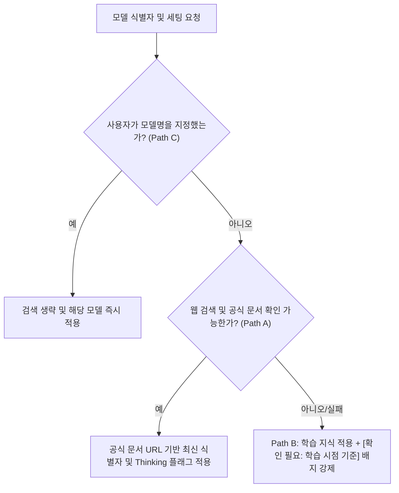

# Universal Critique Architect: 아키텍처 및 페이즈별 진화 기록

본 문서는 `universal-critique`가 단순한 프롬프트에서 프로덕션급 다중 에이전트 오케스트레이션 스킬로 진화한 기술적 여정과 세부 아키텍처 결정을 상세히 기록합니다.

---

## 1. 핵심 아키텍처 원칙 (Core Principles)

### 1) 환각 차단 및 근거 중심성 (Zero-Hallucination & Grounding)
- **문제점:** LLM은 결함을 찾아내라는 지시를 받으면 존재하지 않는 버그나 논리적 오류를 날조(Hallucination)하는 경향이 있음.
- **해결책:** 모든 지적 항목은 반드시 실제 원문 인용(Exact Quote) 또는 검증된 줄 번호와 함께 결함이 발생하는 시스템적 충격(Impact Statement)을 1:1로 증명해야 함.

### 2) 결함 없음 출구 조항 (The Exit Clause)
- 무결한 설계나 정교한 알고리즘을 억지로 트집 잡지 않도록 각 축마다 `[정상(Pass): 결함 없음]`을 명시적으로 선언할 수 있는 정규 퇴로를 의무화.

### 3) 3단 공식 스펙 판별 (3-Tier Fallback Engine)

### 4) 토큰 폭발 방지 및 인라인 무변조 원칙 (Token Safeguard & Zero Drift)
- 작업물 3,000자 기준 자동 분기:
  - **<= 3,000자:** 모델의 임의 재작성을 엄격히 금지하고 원본의 모든 공백 및 주석을 1:1 보존한 라인 넘버링 인라인 제공.
  - **> 3,000자:** 인라인 생성을 전면 차단하고 `[[붙여넣기 슬롯]]`을 생성하여 토큰 폭발 방지. 슬롯이 비어있을 경우 감사를 거부하는 안전 가드레일 내장.

---

## 2. 페이즈별 진화 매트릭스 (Phase Evolution Matrix)

| 버전 | 주요 변경 사항 | 클로드 평가 점수 | 핵심 탈락/통과 사유 |
| :---: | :--- | :---: | :--- |
| **v1.0** | 초기 범용 비평 프롬프트 | 38 / 100 | 대형 문서 100% 인라인 강제로 토큰 폭발, 검색 실패 시 폴백 금지로 먹통 발생 |
| **v1.1** | Frontmatter 및 기본 루브릭 보강 | 52 / 100 | 구조는 잡혔으나 기밀 노출 및 웹 UI 가짜 줄 번호 환각 잔존 |
| **v2.0** | 3단 Chaining, 3단 폴백, Progressive Intake | 74 / 100 | 근거 중심성 강화되었으나 웹 UI 줄 번호 인용과 인라인 규칙 상충 |
| **v2.1** | 출구 조항(Pass) 및 인용 규칙 정밀화 | 86 / 100 | 슬롯 방식과 인라인 방식의 인용 규칙 충돌 1건 잔존 |
| **v2.2** | 클라우드 기밀 경고 외부 분리, 마스킹 범위 확대 | 91 / 100 | **프로덕션 도입 적합 판정.** 사소한 마스킹 결함 가림 지적 |
| **v2.3** | `[REDACTED:TYPE]` 타입 보존 마스킹 및 교차 검증 도구 배정 | 91 / 100 | 이론적 결함 없음. 실전 스트레스 테스트 3부작 진입 |
| **v2.4** | 포렌식 로그 감사 기반 하든닝 (줄 번호 1:1 보존, `read_file` 강제 등) | **프로덕션 하든드 (Final)** | 실제 모델 실행 시의 미세 오차(타이핑 누락, 기억 인용, 빈 슬롯) 원천 차단 |
